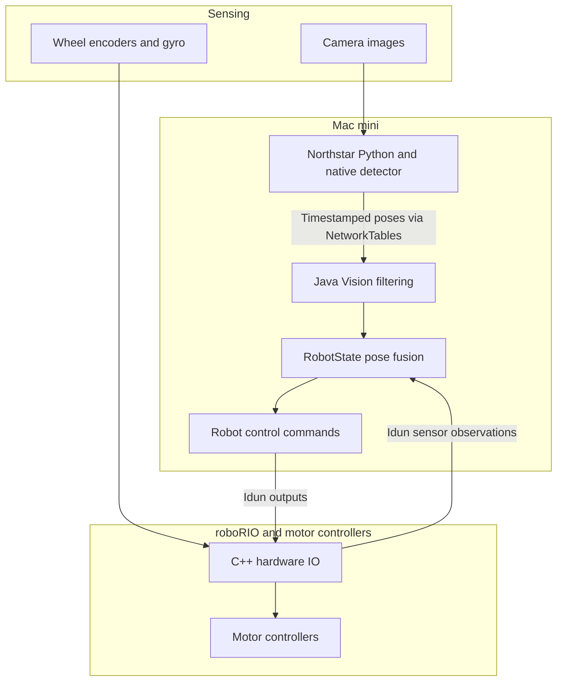
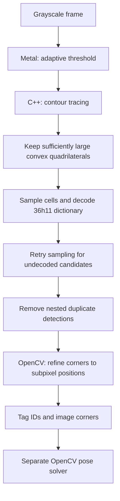
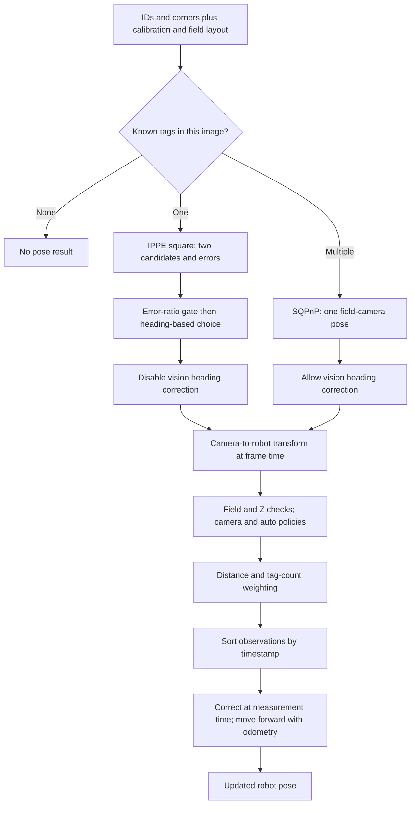
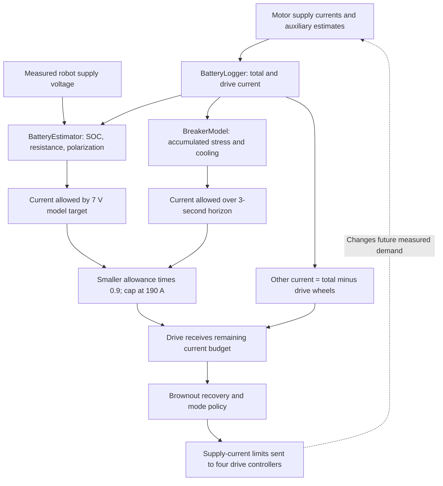
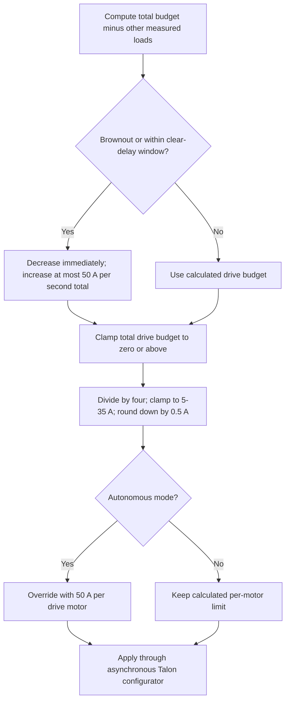
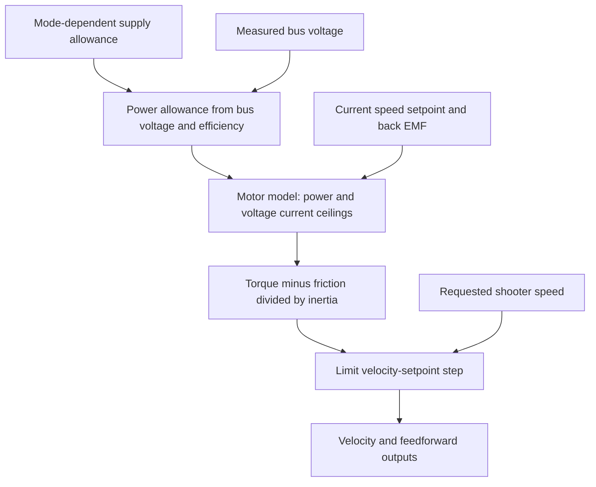

# Architecture diagrams

These diagrams describe the reviewed October 17, 2026 source. Arrows represent data or software commands, not electrical wiring. GitHub renders the fenced Mermaid blocks in normal Markdown view. See [vision](01-VISION-WALKTHROUGH.md), [power](02-POWER-WALKTHROUGH.md), and [source versions](06-EVIDENCE-AND-HISTORY.md) for qualifications.

## 1. Vision deployment and control boundary

The detector and robot pose estimator are separate programs/layers even though the deployment places both on the Mac mini. The power algorithms do not intrinsically require that architecture. Sources: [Northstar main][M-NSMAIN], [Vision][M-VISION], [RobotState][M-STATE], [robot scheduling][M-ROBOT], [hardware IO][M-MODULECPP].

## 2. Aruco Max detection within Northstar

Only the thresholding stage shown is explicitly implemented with Metal. Rejected candidates do not become accepted tags merely by reaching the next box; each stage retains only candidates satisfying its checks. Sources: [detector][M-DETECT], [Metal kernels][M-METAL], [worker wiring][M-WORKER].

## 3. From detected corners to a corrected robot position

This is the dependency flow, not a line-by-line call-order diagram. Failed gates discard the observation. Camera 1 is normally withheld unless camera 0 disconnects, and fusion is withheld for the first two autonomous seconds. Sources: [pose solve][M-PNP], [robot-side policies][M-VISION], [constants][M-VCONST], [history correction][M-STATE].

## 4. Power estimation and feedback

The returned drive limits have floors, caps, and an autonomous override. Consequently the total-budget box is a control target, not an enforced electrical ceiling. Sources: [FinanceDepartment][M-FIN], [logger][M-LOGGER], [battery][M-BAT], [breaker][M-BREAK].

## 5. Drive allocation policy, including the exception

The recovery delay is two seconds after brownout clears. It affects the computed drive budget, but autonomous subsequently overrides the returned limit. Sources: [manager][M-FIN], [constants][M-LIMITS], [configurator][M-CONFIGURATOR].

## 6. Separate power-aware flywheel setpoint

This trajectory shaping does not receive a dynamically allocated shooter budget from `FinanceDepartment`. It uses its own mode-selected allowance and the manager's measured voltage. Source: [Flywheel][M-FLY].

<!-- Source references: generated from pinned research baselines. -->

[M-BAT]: https://github.com/Mechanical-Advantage/RobotCode2026Public/blob/b2923d6557d4c9bef62d26932cc8a66fea2e07a6/src/main/java/org/littletonrobotics/frc2026/energy/BatteryEstimator.java
[M-BREAK]: https://github.com/Mechanical-Advantage/RobotCode2026Public/blob/b2923d6557d4c9bef62d26932cc8a66fea2e07a6/src/main/java/org/littletonrobotics/frc2026/energy/BreakerModel.java
[M-CONFIGURATOR]: https://github.com/Mechanical-Advantage/RobotCode2026Public/blob/b2923d6557d4c9bef62d26932cc8a66fea2e07a6/src/main/cpp/util/TalonFXCurrentConfigurator.cpp
[M-DETECT]: https://github.com/Mechanical-Advantage/RobotCode2026Public/blob/b2923d6557d4c9bef62d26932cc8a66fea2e07a6/northstar/aruco_max_cpp/aruco_max.h
[M-FIN]: https://github.com/Mechanical-Advantage/RobotCode2026Public/blob/b2923d6557d4c9bef62d26932cc8a66fea2e07a6/src/main/java/org/littletonrobotics/frc2026/energy/FinanceDepartment.java
[M-FLY]: https://github.com/Mechanical-Advantage/RobotCode2026Public/blob/b2923d6557d4c9bef62d26932cc8a66fea2e07a6/src/main/java/org/littletonrobotics/frc2026/subsystems/launcher/flywheel/Flywheel.java
[M-LIMITS]: https://github.com/Mechanical-Advantage/RobotCode2026Public/blob/b2923d6557d4c9bef62d26932cc8a66fea2e07a6/src/main/java/org/littletonrobotics/frc2026/energy/CurrentLimits.java
[M-LOGGER]: https://github.com/Mechanical-Advantage/RobotCode2026Public/blob/b2923d6557d4c9bef62d26932cc8a66fea2e07a6/src/main/java/org/littletonrobotics/frc2026/energy/BatteryLogger.java
[M-METAL]: https://github.com/Mechanical-Advantage/RobotCode2026Public/blob/b2923d6557d4c9bef62d26932cc8a66fea2e07a6/northstar/aruco_max_cpp/metal_context.cpp
[M-MODULECPP]: https://github.com/Mechanical-Advantage/RobotCode2026Public/blob/b2923d6557d4c9bef62d26932cc8a66fea2e07a6/src/main/cpp/subsystems/ModuleIOTalonFX.cpp
[M-NSMAIN]: https://github.com/Mechanical-Advantage/RobotCode2026Public/blob/b2923d6557d4c9bef62d26932cc8a66fea2e07a6/northstar/__init__.py
[M-PNP]: https://github.com/Mechanical-Advantage/RobotCode2026Public/blob/b2923d6557d4c9bef62d26932cc8a66fea2e07a6/northstar/pipeline/CameraPoseEstimator.py
[M-ROBOT]: https://github.com/Mechanical-Advantage/RobotCode2026Public/blob/b2923d6557d4c9bef62d26932cc8a66fea2e07a6/src/main/java/org/littletonrobotics/frc2026/Robot.java
[M-STATE]: https://github.com/Mechanical-Advantage/RobotCode2026Public/blob/b2923d6557d4c9bef62d26932cc8a66fea2e07a6/src/main/java/org/littletonrobotics/frc2026/RobotState.java
[M-VCONST]: https://github.com/Mechanical-Advantage/RobotCode2026Public/blob/b2923d6557d4c9bef62d26932cc8a66fea2e07a6/src/main/java/org/littletonrobotics/frc2026/subsystems/vision/VisionConstants.java
[M-VISION]: https://github.com/Mechanical-Advantage/RobotCode2026Public/blob/b2923d6557d4c9bef62d26932cc8a66fea2e07a6/src/main/java/org/littletonrobotics/frc2026/subsystems/vision/Vision.java
[M-WORKER]: https://github.com/Mechanical-Advantage/RobotCode2026Public/blob/b2923d6557d4c9bef62d26932cc8a66fea2e07a6/northstar/apriltag_worker.py
