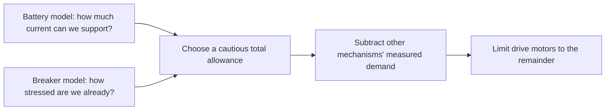

# How 6328 helps its robot see and share electrical power

Student introduction, October 17, 2026. This guide describes the public code we inspected. It does not claim that we tested these systems on our robot.

## Seeing an AprilTag is only the first step

Imagine taking a picture of a square sign across the field. The software has to find its four corners, read its number, and work out how far away and tilted it is. Then it has to account for where the camera is mounted on the robot.

Even after that, the picture is already a little old. The robot may have moved while the image was being processed. Wheel encoders and the gyro help connect that old picture to where the robot is now.

6328 calls its vision system **Northstar**. The version we inspected uses a custom detector called **Aruco Max**. It is based on an existing detector called ArUco Nano and reads ordinary field AprilTags. One image-processing step runs on the Mac's GPU to help with the workload. [Detector and origin][M-WRAP], [processing][M-DETECT].

The GPU does not magically know where the robot is. It helps turn the image into a useful black-and-white representation. Other code finds the tag, refines its corners, solves the geometry, and combines the result with motion sensors.

## Why can one tag be confusing?

A square seen from certain angles can look consistent with two different poses. Northstar sends both possibilities. The robot code checks how clearly one fits the image better, then uses the robot's estimated heading to choose between them. With only one tag, it does not use that camera result to correct the robot's heading.

When several known tags are visible in one image, their combined geometry gives more information. The code can solve one pose from all their corners. [Pose solver][M-PNP], [robot-side selection][M-VISION].

A wrong camera mounting measurement still creates a wrong robot position. Better detection does not remove the need to calibrate the lens, measure the mount, choose the correct field layout, and check timestamps.

## Does this mean PhotonVision is bad?

No. The checked PhotonVision 2026 version already supports multiple tags, several pose-solving strategies, and queued camera results. It also offers both AprilTag and ArUco detection paths. 6328 has chosen to maintain a more specialized system for its hardware. That is a different engineering choice, not proof that our team should replace PhotonVision. [PhotonVision pipelines][P-ARUCO], [strategies][P-POSE], [queues][P-CAMERA].

For us, the useful question is: **what is making our estimate wrong?** If the camera finds good corners but our mount measurement is wrong, a new detector solves the wrong problem. If images are blurred, camera exposure and mounting may matter more than the pose algorithm.

## The robot has one shared electrical supply

The battery supplies the drive, shooter, intake, computers, and other devices. When several motors demand large current at once, the battery voltage can drop. If it drops too far, parts of the robot may stop functioning properly. This can happen before the battery is completely empty.

There is also a different problem: the main breaker heats under sustained overload. A short burst that was fine earlier may be a problem after the robot has been working hard for a while.

6328's software manager is named **FinanceDepartment**. Think of it as a budget planner:

The battery model remembers estimated charge and recent loading. The breaker model remembers accumulated stress and lets it decrease while current is low. Neither is a temperature sensor measuring every wire. [Battery][M-BAT], [breaker][M-BREAK].

## A simple example

Suppose the manager allows 190 A total and the other mechanisms are using 110 A. There are 80 A left for the four drive motors, so the calculated limit is 20 A each.

Now suppose shooting and other loads rise to 150 A. Only 40 A remain, so the limit becomes 10 A per drive motor. The drive can no longer demand as much current, which helps the shared voltage while the mechanisms are busy.

The software does not move electricity into a “shooter account.” All devices still share the battery. It restricts drive demand. A motor current limit also does not force a motor to use that much current. [Budget calculation][M-FIN].

The shooter has another useful feature: its requested speed increases at a rate estimated from available voltage and motor physics. Asking for an achievable acceleration can work better than demanding an instant jump to full speed. [Shooter setpoint algorithm][M-FLY].

## The exceptions are part of the lesson

Their published code has robot-specific choices:

- Outside autonomous, each drive motor is limited between 5 A and 35 A.
- In autonomous, it uses a fixed 50 A per drive motor instead of the adaptive result.
- The 5 A minimum means that an almost-empty drive budget is not enforced exactly.
- A model can be wrong if it receives wrong current readings or is tuned for a different battery.

These details are why “copy the code” is not the same as “understand the solution.” [Limits][M-LIMITS], [mode policy][M-FIN].

## What we can learn and try

For vision, measure camera detection quality, calibration accuracy, timestamps, and the final robot-position error separately. For power, first record voltage and current while driving, spinning the shooter, and doing both together. Then run a proposed budget in the log without letting it change the robot. Compare its predictions to what actually happened.

Only after those checks should we test automatic limiting. Our [mentor roadmap](05-MECHARAMS-ROADMAP.md) describes the stages. The goal is for students to be able to explain **why** the robot chose a limit and **what evidence** shows it helped.

Discussion questions:

1. If a tag is detected but the robot position is wrong, which stages could be responsible?
2. Why can a battery with charge remaining still have a voltage-sag problem?
3. Why does the breaker model need memory of earlier current?
4. Why is a 20 A current limit different from a command to draw 20 A?
5. What could go wrong if a disconnected current sensor is counted as zero load?

<!-- Source references: generated from pinned research baselines. -->

[M-BAT]: https://github.com/Mechanical-Advantage/RobotCode2026Public/blob/b2923d6557d4c9bef62d26932cc8a66fea2e07a6/src/main/java/org/littletonrobotics/frc2026/energy/BatteryEstimator.java
[M-BREAK]: https://github.com/Mechanical-Advantage/RobotCode2026Public/blob/b2923d6557d4c9bef62d26932cc8a66fea2e07a6/src/main/java/org/littletonrobotics/frc2026/energy/BreakerModel.java
[M-DETECT]: https://github.com/Mechanical-Advantage/RobotCode2026Public/blob/b2923d6557d4c9bef62d26932cc8a66fea2e07a6/northstar/aruco_max_cpp/aruco_max.h
[M-FIN]: https://github.com/Mechanical-Advantage/RobotCode2026Public/blob/b2923d6557d4c9bef62d26932cc8a66fea2e07a6/src/main/java/org/littletonrobotics/frc2026/energy/FinanceDepartment.java
[M-FLY]: https://github.com/Mechanical-Advantage/RobotCode2026Public/blob/b2923d6557d4c9bef62d26932cc8a66fea2e07a6/src/main/java/org/littletonrobotics/frc2026/subsystems/launcher/flywheel/Flywheel.java
[M-LIMITS]: https://github.com/Mechanical-Advantage/RobotCode2026Public/blob/b2923d6557d4c9bef62d26932cc8a66fea2e07a6/src/main/java/org/littletonrobotics/frc2026/energy/CurrentLimits.java
[M-PNP]: https://github.com/Mechanical-Advantage/RobotCode2026Public/blob/b2923d6557d4c9bef62d26932cc8a66fea2e07a6/northstar/pipeline/CameraPoseEstimator.py
[M-VISION]: https://github.com/Mechanical-Advantage/RobotCode2026Public/blob/b2923d6557d4c9bef62d26932cc8a66fea2e07a6/src/main/java/org/littletonrobotics/frc2026/subsystems/vision/Vision.java
[M-WRAP]: https://github.com/Mechanical-Advantage/RobotCode2026Public/blob/b2923d6557d4c9bef62d26932cc8a66fea2e07a6/northstar/aruco_max_cpp/wrapper.cpp
[P-ARUCO]: https://github.com/PhotonVision/photonvision/blob/a5be3d062ce5c145f4a759b0207057f218cda6b3/photon-core/src/main/java/org/photonvision/vision/pipeline/ArucoPipeline.java
[P-CAMERA]: https://github.com/PhotonVision/photonvision/blob/a5be3d062ce5c145f4a759b0207057f218cda6b3/photon-lib/src/main/java/org/photonvision/PhotonCamera.java
[P-POSE]: https://github.com/PhotonVision/photonvision/blob/a5be3d062ce5c145f4a759b0207057f218cda6b3/photon-lib/src/main/java/org/photonvision/PhotonPoseEstimator.java
